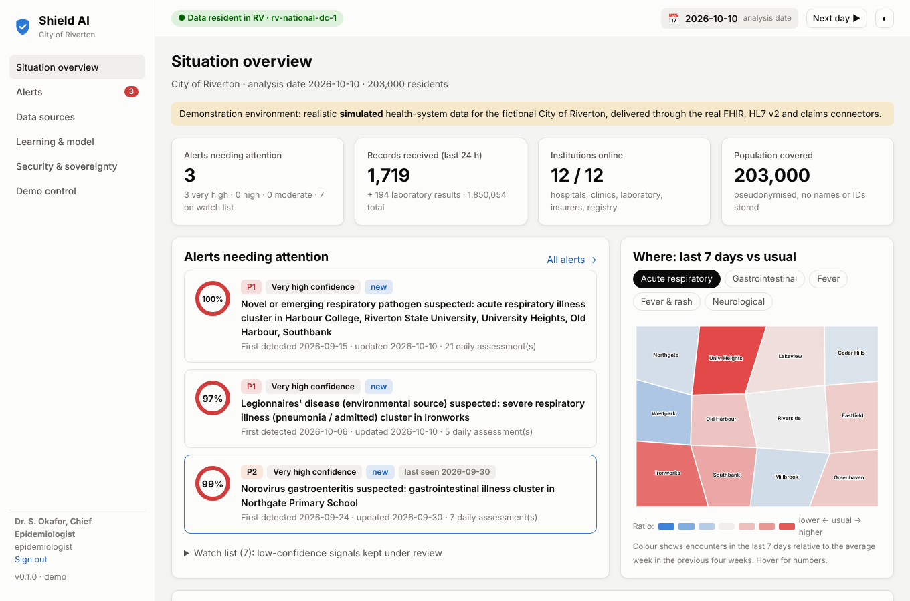
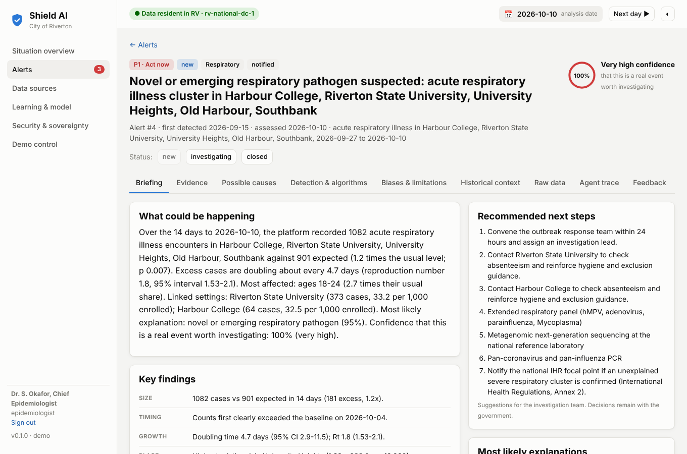
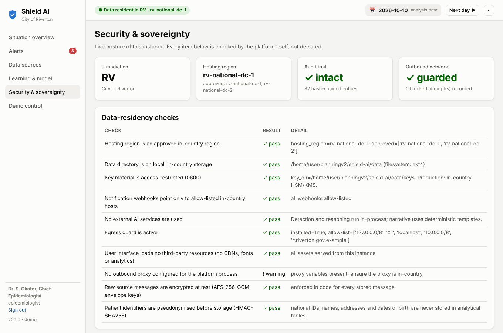

# Shield AI

**Sovereign epidemic intelligence for governments.**

Shield AI connects a country's hospitals, clinics, university health services, laboratories, and health and life insurers. It watches their records every day with the statistical methods national public-health agencies trust, and tells the government early, with evidence, when an outbreak may be starting. Everything it stores and computes stays inside the country, and it can prove that.

This repository is the **MVP**. It runs end to end on a realistic simulation of a 203,000-person city and is built to be pointed at real institutions for a city-scale pilot.



---

## Contents

1. [What it does](#what-it-does)
2. [Run the demo](#run-the-demo)
3. [What the demo shows](#what-the-demo-shows)
4. [How the AI agent works](#how-the-ai-agent-works)
5. [Security and data sovereignty](#security-and-data-sovereignty)
6. [Validation results](#validation-results)
7. [What is real and what is simulated](#what-is-real-and-what-is-simulated)
8. [What you need to know to own and sell this](#what-you-need-to-know-to-own-and-sell-this)
9. [Repository map and documentation](#repository-map-and-documentation)

---

## What it does

| Capability | How the MVP delivers it |
|---|---|
| **Connect institutions** | Native connectors. FHIR R4 for hospitals, urgent care, the university clinic and the public health laboratory. HL7 v2.5.1 ADT for community clinics. Daily claims files from health insurers. Death-claim files from life insurers. A pseudonymised enrolment list from the education registry, used to link pupils and students to schools and universities. |
| **Real-time read access** | Every message is validated, pseudonymised, encrypted and de-duplicated across institutions as it arrives. Hospitals report within hours; insurers within days. The platform knows each source's delay and corrects for it. |
| **AI agent that finds outbreaks** | Every day the agent tests about 280 syndrome-by-population series: city-wide, 8 age bands, 12 neighbourhoods, 11 schools and universities, and 8 facilities. It uses 4 time-series detectors, 2 spatial scan statistics and laboratory detectors, with false-discovery control. It then merges related signals into events and links events that are one spreading outbreak. |
| **Explain everything** | For each event: what could be happening, confidence, key findings, the raw records behind it, patterns recognised (curve, growth, Rt, age, place, schools, severity, lab results), the algorithms used, the biases and limitations, and historical context with economic, hospital and mortality impact, with sources. |
| **Government in control** | Officials investigate, change status and give feedback: what was right, what was wrong, the confirmed cause, actions taken and outcomes. The agent re-trains its confidence model, adjusts thresholds, tracks detector reliability and cites the event as local history next time. |
| **Sovereign and auditable** | No external services, CDNs or AI providers. A process-level egress guard blocks any connection outside the in-country allow-list. Encryption, pseudonymisation, role-based access, small-cell suppression and a tamper-evident audit trail are built in. |

---

## Run the demo

Requirements: Python 3.11+, about 1.5 GB disk, about 4 GB RAM. No internet access is needed after installing the dependencies.

```bash
git clone <this repository> shield-ai && cd shield-ai
python3 -m venv .venv && source .venv/bin/activate
pip install -r requirements-dev.txt

make demo     # builds the city, loads 3 years of history, replays 26 days through the connectors (about 10-15 minutes)
make serve    # open http://127.0.0.1:8000
```

| User | Role | What they see |
|---|---|---|
| `minister` | Decision-maker | Findings and aggregates (counts under 5 suppressed); can give feedback |
| `epi` | Epidemiologist | Everything above plus pseudonymised records and export; runs the agent |
| `steward` | Data steward | Institution connections; can decrypt an original message with a written justification |
| `auditor` | Independent auditor | Audit trail and security posture; no health data |

The password for all demo users is `shield-demo`.

**Other commands:**
- `make demo-live` stops the clock on 14 September 2026, the last day of the historical back-fill and before any alert, so you can press **Next day** in front of an audience and watch the outbreaks appear.
- `make test` runs the test suite.
- `make evaluate` scores the agent against the simulation's ground truth.
- `make check` runs the sovereignty checks.
- With Docker: `docker compose run --rm shield python -m shield.cli seed && docker compose up -d`.

The step-by-step presentation is in **[docs/DEMO_SCRIPT.md](docs/DEMO_SCRIPT.md)**.

---

## What the demo shows

The demo jurisdiction is the fictional **City of Riverton**:
- 203,000 residents in 12 neighbourhoods with different age, insurance and care-seeking profiles.
- 2 hospitals, 5 clinics (2 of them university health centres), a public health laboratory, a public and a private health insurer, a life insurer and the education registry.
- One private clinic has **no** direct feed and is visible only through insurance claims, as in real life.

Three years of realistic background activity are simulated:
- Influenza seasons of different timing and severity, RSV in infants, SARS-CoV-2 waves, winter norovirus, summer foodborne illness and back-to-school colds.
- Weekday and holiday patterns, and students leaving the city in summer.
- Reporting delays, missing codes, triage-note abbreviations and typos.

On top of that background, five events are injected. The agent never sees which:

| Simulated event | What the agent did |
|---|---|
| **Measles** among under-vaccinated children, February-April 2024 (historical) | Alerted on 18 March 2024 from measles diagnoses and positive IgM tests. The demo includes the epidemiologist's feedback from that time, so it appears as local history. |
| **Novel respiratory pathogen** introduced at Riverton State University, 6 September 2026. Standard lab panels are negative, as they were for SARS-CoV-2 in December 2019. | Alerted on 15 September at the university, nine days after introduction, when 13 patients had sought care. At first it read as a possible COVID-19 wave. From 22 September, as respiratory panels kept coming back negative, the same alert's leading explanation became **"novel or emerging respiratory pathogen"**, with doubling time, Rt and spread to Harbour College and Old Harbour. P1. |
| **Norovirus** point-source outbreak at Northgate Primary School, 22 September 2026 | Alerted on 24 September, the day after the first children sought care, with norovirus-positive stool tests. |
| **Legionnaires' disease** from a cooling tower in Ironworks, exposures from 24 September 2026 | Alerted on 6 October as a severe-pneumonia cluster in older adults, with positive Legionella urinary antigens. Recommends cooling-tower sampling. P1. |
| **Not an outbreak:** after an EHR upgrade, St. Mary's Medical Center codes abdominal pain as infectious gastroenteritis (from 1 October 2026) | At first it looked like a gastrointestinal rise. Within three days it was re-explained as a **probable data artefact**: one source, a sudden shift in code A09, triage text that does not match, and no other institution affected. It stayed on the watch list and was never notified. |

Exact dates and numbers are in [Validation results](#validation-results).



---

## How the AI agent works

The agent is a fixed, auditable sequence of steps. Each run stores a trace that the interface shows, so anyone can see exactly what it did.

1. **Load** the pseudonymised records received up to today. Late records stay invisible, as in real life.
2. **Detect** with methods used by CDC, UKHSA, ECDC and NYC DOHMH:
   - Robust quasi-Poisson regression with seasonality, trend, day-of-week, holidays and a same-season historical profile.
   - **Farrington Flexible**, the UK and European standard.
   - **EARS C1-C3** and **CUSUM** for sharp and gradual rises.
   - **Kulldorff's space-time permutation scan**, as in SaTScan.
   - An **expectation-based Poisson scan**.
   - Laboratory detectors, including "panels negative for every known virus", the fingerprint of a new pathogen.
   - **Notifiable-condition rules**, where a single coded case of measles, meningococcal disease or similar raises an alert.
   - **Benjamini-Hochberg** control of false discoveries across all of it.
3. **Fuse** related signals into events and **link** events that are one spreading outbreak.
4. **Characterise.**
   - Epidemic curve against expectation, with a nowcast for records still in transit.
   - Doubling time and reproduction number (Cori/EpiEstim).
   - Who (age, sex), where (neighbourhoods, schools, universities), how severe.
   - What the labs say, which institutions see it, and whether diagnosis coding changed.
5. **Diagnose.** A Bayesian differential across pathogens, "data artefact" and "chance variation", with an evidence-for and evidence-against ledger.
6. **Score confidence** with a logistic model over 12 interpretable features. It starts from expert weights and is **re-trained from government feedback**.
7. **Assess biases:** coverage gaps, reporting delay, testing bias, single-source dependence, small numbers, multiple testing, care-seeking differences, coding quality and model assumptions. Each is quantified where possible.
8. **Add historical context.** Comparable outbreaks (1918, 2009 H1N1, SARS, MERS, COVID-19, Milwaukee 1993, Germany 2011 E. coli, South Bronx 2015 Legionnaires', Samoa 2019 measles, norovirus burden, Ebola 2014-16) with published cases, hospitalisations, deaths, economic and social impact, and sources. Published rates are scaled to the affected population.
9. **Brief and notify.** Title, summary, key findings and recommended next steps. Alerts are updated day by day as evidence changes.
   - **When it notifies:** confidence must reach 50% on two consecutive days. Confidence of 80% or more notifies immediately if more than one institution sees the rise. A notifiable diagnosis notifies immediately.
   - **Below that:** signals stay on a watch list for analysts.
   - **Channels:** the in-app inbox and optional in-country webhooks.

**About the "AI".** Detection and reasoning are statistical and Bayesian, not a large language model. This is deliberate:
- These are the methods public-health agencies already validate and trust.
- They give calibrated uncertainty.
- They are explainable line by line.
- They run on a single in-country server.

An optional language model can rewrite the summary in plain language. It must be hosted in-country, it never sees records, and the computed facts are always shown alongside it. Full detail: **[docs/ALGORITHMS.md](docs/ALGORITHMS.md)**.

---

## Security and data sovereignty

| Guarantee | How |
|---|---|
| Data stays in the country | No third-party services. Start-up checks on hosting region, storage, keys, integrations and front-end assets. A process-level **egress guard** blocks every non-allow-listed connection, and you can try it live on the Security page. |
| Minimum data, no identities | National IDs become keyed pseudonyms (HMAC-SHA256). Birth dates become ages and postcodes become neighbourhoods. Names, addresses and phone numbers are never stored for analysis. |
| Originals encrypted | AES-256-GCM with a fresh key per message, wrapped by a key-encryption key. Decryption is break-glass only, needs a written justification, and is logged. |
| Least privilege | Four roles. Small counts are suppressed for decision-makers. Exports are classified, attributed and hashed. |
| Tamper-evident accountability | A hash-chained audit log of every login, view, export, decryption, ingestion, agent run, notification and piece of feedback, with a one-click integrity check. |
| Hardened web app | Strict Content-Security-Policy, no third-party scripts, a hand-written SVG chart library, scrypt passwords, signed expiring tokens, and per-institution ingestion credentials. |

What production adds: government identity provider with MFA, in-country HSM/KMS, mTLS to institutions, PostgreSQL, penetration testing and certification. The legal basis and governance are just as important. See **[docs/SECURITY_AND_SOVEREIGNTY.md](docs/SECURITY_AND_SOVEREIGNTY.md)**.



---

## Validation results

Produced by `make evaluate` after `make demo`. Every row compares the agent's alerts with the simulation's ground truth, which the agent never reads. All data reached the platform through the connectors, day by day.

| Scenario | Started | First patient sought care | First alert | First notified | Leading explanation at first alert | Final explanation | Final confidence |
|---|---|---|---|---|---|---|---|
| Measles outbreak among under-vaccinated children | 2024-02-26 | 2024-03-01 | 2024-03-18 | historical run (notifications off) | Measles | Measles | 90% |
| Novel respiratory pathogen introduced at a university | 2026-09-06 | 2026-09-12 | 2026-09-15 | 2026-09-15 | COVID-19 (SARS-CoV-2) wave | Novel or emerging respiratory pathogen | 100% |
| Norovirus outbreak at Northgate Primary School | 2026-09-22 | 2026-09-23 | 2026-09-24 | 2026-09-24 | Norovirus gastroenteritis | Norovirus gastroenteritis | 99% |
| Legionnaires' disease cluster linked to a cooling tower | 2026-09-24 | 2026-09-28 | 2026-10-06 | 2026-10-06 | Legionnaires' disease (environmental source) | Legionnaires' disease (environmental source) | 97% |
| EHR upgrade coding artefact (not a real outbreak) | 2026-10-01 | 2026-10-01 | 2026-10-01 | not notified | Norovirus gastroenteritis | Data or coding artefact (not a real increase in illness) | 50% |

**False alarms.** 8 of 14 alerts did not correspond to a simulated event; 0 of those were notified; the rest stayed on the watch list. Watch-list items are visible to analysts but do not trigger notifications.

**How to read this:**
- **Novel pathogen.** Alerted 9 days after introduction, when 13 patients had sought care. Its first visit was on 2026-09-12. The leading explanation started as "COVID-19 (SARS-CoV-2) wave" and became "Novel or emerging respiratory pathogen" as negative laboratory panels accumulated.
- **Norovirus.** Alerted 1 day after the first children sought care.
- **Legionnaires'.** Alerted 8 days after the first patient presented, once 15 cases, admissions and positive urinary antigens had accumulated.
- **Measles.** Alerted 17 days after the first case presented, from measles diagnoses and IgM results.
- **Coding artefact.** It first looked like a gastrointestinal rise (Norovirus gastroenteritis). It was re-explained as a data artefact on 2026-10-04, and was never notified.
- **Notification rule.** Confidence must be at least 50% on two consecutive days. At 80% or more, an alert notifies immediately if more than one institution sees the rise. A notifiable diagnosis also notifies immediately.

**Limitation.** These results come from one simulated scenario set. The parameters were tuned on the same simulator. In testing before the final notification rule was added, starting the replay earlier (10 September) produced several notified false alarms around the return to school. That start date has not been re-tested since. Real-world sensitivity and false-alarm rates must be measured during a silent-running pilot with local feedback.

---

## What is real and what is simulated

| Real (production-grade logic you can run against real feeds) | Simulated (for the demo) |
|---|---|
| FHIR, HL7 v2, claims, death-claim and registry connectors, and their parsing, validation and de-duplication | The institutions and their messages |
| Pseudonymisation, encryption, egress guard, residency checks, RBAC, disclosure control, audit chain | The city, its population and its census |
| All detection, characterisation, diagnosis, confidence, learning, bias and history logic | The five outbreak and artefact scenarios |
| The web application and API | The clock (you can advance and rewind it) |
| The historical knowledge base (real events, published figures, sources) | |

The simulator (`shield/synth/`) is itself an asset. It lets you rehearse, test changes safely, and show a government what the platform would do before any real data is connected.

---

## What you need to know to own and sell this

1. **The pitch in one sentence.** "Every day, Shield AI reads the health system as a whole, inside your borders, and tells you early, with evidence and honest uncertainty, when something is starting, so you can act in days rather than months."
2. **The biggest hurdle is legal, not technical.**
   - Read access to every citizen's records needs explicit statutory authority, a data-protection impact assessment, data-sharing agreements and independent oversight.
   - Start these conversations at the same time as the technical pilot. The MVP's design (minimisation, pseudonymisation, purpose limitation, audit, role separation) exists to make that legal case.
   - See [docs/SECURITY_AND_SOVEREIGNTY.md](docs/SECURITY_AND_SOVEREIGNTY.md#legal-basis).
3. **Be honest about the MVP.**
   - It is validated on simulation, not on real outbreaks.
   - It has not been penetration-tested or certified.
   - It uses SQLite and password login.
   - The detection methods are established. Their calibration for a given country comes from a 3-6 month silent-running period with local feedback.
4. **What a pilot needs from the government.**
   - Census and boundary data.
   - 3-5 willing institutions (start with the public health lab and a public hospital) and at least 2 years of historical extracts.
   - In-country hosting and identity integration.
   - A small epidemiology team to review alerts.
5. **Why governments can trust it.**
   - Nothing leaves the country, and the platform proves it.
   - Every alert is explained down to the record.
   - The system says when it is unsure, and when a rise is probably a data problem.
   - Officials stay in charge.
6. **Where the product goes next.** More sources (pharmacy sales, school absenteeism, ambulance calls, wastewater), forecasting of cases and beds, an in-country language assistant, IHR reporting, and regional or federated national deployments. See [docs/ROADMAP.md](docs/ROADMAP.md).
7. **Ownership.**
   - The code is yours. It is proprietary, see [LICENSE](LICENSE).
   - It depends only on mainstream open-source Python libraries (FastAPI, NumPy, pandas, SciPy, cryptography) with permissive licences.
   - The front end has no third-party code at all.
8. **Before an official presentation,** re-check the historical figures against the cited sources and replace the fictional city with the audience's own geography if you can (`shield/synth/city.py`).

---

## Repository map and documentation

```
shield/
  ingest/        connectors (FHIR, HL7 v2, claims, deaths, registry) and the ingestion pipeline
  nlp/           syndrome classifier
  detect/        statistical methods (GLM, Farrington, EARS, CUSUM, scan statistics, Rt, nowcasting)
  agent/         the surveillance agent (detection, fusion, characterisation, diagnosis, confidence & learning,
                 biases, history, narrative, notifications, orchestrator)
  security/      keys & encryption, pseudonymisation, audit chain, auth/RBAC, disclosure control, residency & egress guard
  knowledge/     pathogen profiles and historical outbreak knowledge base (with sources)
  api/           HTTP API and web hosting
  web/           the interface (vanilla JS, hand-written SVG charts)
  synth/         the Riverton simulator and native-format feeds
  demo.py        seed / replay / rewind
  evaluation.py  agent vs. ground truth
  cli.py         command-line tools
tests/           security, connectors, classifier, detectors, API
docs/            architecture, algorithms, security & sovereignty, deployment, demo script, roadmap
config/          example deployment configuration
```

| Document | Read it for |
|---|---|
| [docs/DEMO_SCRIPT.md](docs/DEMO_SCRIPT.md) | Presenting to a government (25-35 minutes, with expected questions) |
| [docs/ARCHITECTURE.md](docs/ARCHITECTURE.md) | Components, data flow, data model, MVP vs. production |
| [docs/ALGORITHMS.md](docs/ALGORITHMS.md) | Every method, its role and references, and known limitations |
| [docs/SECURITY_AND_SOVEREIGNTY.md](docs/SECURITY_AND_SOVEREIGNTY.md) | Controls, what production adds, the legal basis |
| [docs/DEPLOYMENT.md](docs/DEPLOYMENT.md) | Running it, configuration, connecting real institutions, sizing |
| [docs/ROADMAP.md](docs/ROADMAP.md) | Pilot, operational and national phases; risks |

---

Copyright (c) 2026 Anmol Parashar. All rights reserved.
